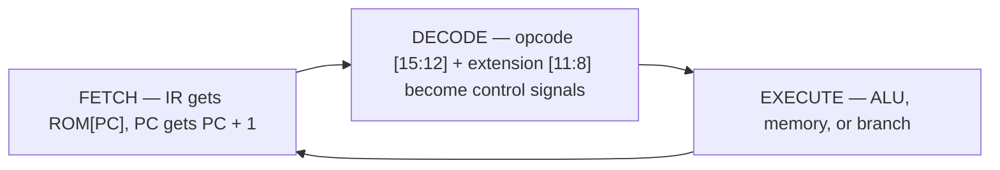
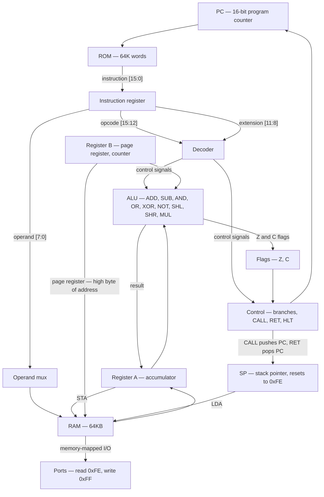

# tiny8

[](src/tiny_cpu.v)
[](run.sh)
[](tools/model.py)
[](EXPLAINED_FOR_BEGINNERS.md)

A minimal 8-bit accumulator CPU in Verilog, built from zero. Current version:
**v6**.

New to CPU design? [`EXPLAINED_FOR_BEGINNERS.md`](EXPLAINED_FOR_BEGINNERS.md)
explains the same material in plain language, with verified and unproven
claims labelled separately.

## Problem

Textbook CPUs are either toy diagrams with no working silicon or full
cores too large to hold in your head. tiny8 is the middle ground: a real,
simulated CPU — fetch, decode, execute, flags, stack, memory-mapped I/O —
small enough that one person can understand every line of it, with a Python
model that cross-checks the Verilog instruction by instruction.

## CPU spec

| Item | Detail |
|---|---|
| Data path | 8-bit |
| Instruction word | 16-bit: `[15:12]` opcode, `[11:8]` extension, `[7:0]` operand |
| Architecture | Harvard memory (separate ROM and RAM) |
| Registers | A (accumulator), B (second register, v3), 16-bit program counter (v6), SP (stack pointer) |
| ROM | 64K words (v6); 256 words through v4 |
| RAM | 64KB (v5+); 256 bytes through v4 |
| Timing | Multi-cycle: every instruction takes FETCH + EXECUTE — two clocks |
| Stack | Grows down from the top of RAM; SP resets to `0xFE` |
| Flags | Z (zero), set by ALU and load results only; C (carry/borrow, v4), set by ADD/ADDI/ADDB carry and SUB/SUBB/CMP borrow, left alone by everything else — so JC/JNC branch on unsigned comparisons |
| I/O | Memory-mapped ports: read `0xFE` for input pins, write `0xFF` for output pins |
| Implementation | `src/tiny_cpu.v` (282 lines), `src/tt_tiny8.v` TinyTapeout wrapper (43 lines) |

### Datapath — fetch, decode, execute

Every instruction takes two clocks: FETCH, then EXECUTE.





Harvard memory: instructions come from ROM, data lives in RAM, and the
stack grows down from the top of RAM. Register B doubles as the page
register, so `LDAX`/`STAX` and the far jumps reach any 64KB page.

Design rules that fall out of the flag behaviour: Z is set by ALU/load
results only. STA, JMP, JZ, JNZ, CALL, RET, HLT and NOP leave it alone,
which is what makes `ADD` + `JZ`/`JNZ` loops work. Keep program data below
`0xF0` so deep calls never collide with the stack, and never RET without a
CALL.

## Version history

Each version added capability in the formerly reserved `[11:8]` extension
field, so earlier programs assemble identically and run unchanged, with
identical step counts.

| Version | Change |
|---|---|
| v1 | Base ISA: 16 opcodes, 256-word ROM, 256-byte RAM, Z flag. |
| v2 | JNZ, CALL, RET in the extension field; stack grows down from top of RAM. |
| v3 | Register B, plus TAB, TBA, ADDB, SUBB, PUSH, POP. LDI loads A only, so B survives across it and works as a counter or saved value. |
| v4 | Carry/borrow flag C, CMP, JC, JNC, and hardware multiply (MUL). |
| v5 | 64KB RAM. B is the page register: LDAX/STAX address `(B << 8) \| operand`, while zero-page instructions still use addresses 0..255. In simulation the RAM is a 64KB array; a real chip would use SRAM, not flip-flops. |
| v6 | 16-bit program counter and 64K-word ROM, so programs are no longer capped at 256 words. JMPF/JZF jump to `(B << 8) \| operand`. CALL/RET push and pop a 16-bit return address (high byte first). A far call needs no new opcode: push the return address, set B to the page, JMPF, and RET pops it back. The assembler gained ORG. |

## Instruction set

Base opcodes:

| Opcode | Mnemonic | Behaviour |
|--------|----------|-----------|
| 0x0 | NOP | do nothing |
| 0x1 | LDI imm | A ← imm |
| 0x2 | LDA addr | A ← MEM[addr] |
| 0x3 | STA addr | MEM[addr] ← A |
| 0x4 | ADD addr | A ← A + MEM[addr] |
| 0x5 | ADDI imm | A ← A + imm |
| 0x6 | SUB addr | A ← A − MEM[addr] |
| 0x7 | AND addr | A ← A & MEM[addr] |
| 0x8 | OR addr | A ← A \| MEM[addr] |
| 0x9 | XOR addr | A ← A ^ MEM[addr] |
| 0xA | NOT | A ← ~A |
| 0xB | SHL | A ← A << 1 |
| 0xC | SHR | A ← A >> 1 |
| 0xD | JMP addr | PC ← addr |
| 0xE | JZ addr | if (Z) PC ← addr |
| 0xF | HLT | halt forever |

Extended instructions (opcode `0x0`, extension in `[11:8]`):

| Ext | Mnemonic | Behaviour |
|-----|----------|-----------|
| 1 | JNZ addr | if (!Z) PC ← addr |
| 2 | CALL addr | push PC; PC ← addr |
| 3 | RET | PC ← pop() |
| 4 | TAB | B ← A (flags untouched) |
| 5 | TBA | A ← B (flags untouched) |
| 6 | ADDB | A ← A + B (sets Z) |
| 7 | SUBB | A ← A − B (sets Z) |
| 8 | PUSH | push A (flags untouched) |
| 9 | POP | A ← pop() (sets Z, like a load) |
| A | CMP addr | compare A with MEM[addr]: A unchanged, Z = equal, C = A < MEM |
| B | JC addr | if (C) PC ← addr |
| C | JNC addr | if (!C) PC ← addr |
| D | MUL | A ← A × B, low byte (sets Z, C untouched) |
| E | LDAX addr | A ← RAM[(B << 8) \| addr] (sets Z, RAM only) |
| F | STAX addr | RAM[(B << 8) \| addr] ← A (flags untouched) |

Far jumps (v6; JMP/JZ with `[11:8]` = 1, B = program page):

| Mnemonic | Behaviour |
|----------|-----------|
| JMPF addr | PC ← (B << 8) \| addr |
| JZF addr | if (Z) PC ← (B << 8) \| addr |

Assembler extras: `ORG <address>` places following code at that address
(padding with HLT); labels work across ORG as usual.

## Files

| Path | What it is |
|---|---|
| `src/tiny_cpu.v` | The CPU (282 lines) |
| `src/tt_tiny8.v` | TinyTapeout wrapper (ui_in → in_port, uo_out → out_port, halted on uio_out[0]); compiles, not a submission |
| `tools/asm.py` | Two-pass assembler (labels, decimal/`0x` operands) |
| `tools/model.py` | Python behavioural model, cross-checks the Verilog |
| `tools/play_guess.py` | Console driver for the guess-the-number game |
| `sim/tb_cpu.v`, `tb_guess.v`, `tb_v2.v`–`tb_v6.v` | Testbenches, print PASS/FAIL |
| `programs/` | 13 programs (`.asm` + `.hex`): sum1to10, guess, fib, call_demo, multiply, push_pop, regb_demo, guess255, mul_demo, cmp_flags, page_demo, far_demo, far_cond |
| `run.sh` | Assembles, runs the Python model, compiles and simulates the Verilog |

## Run it

```sh
./run.sh        # assembles, runs the Python model, compiles + simulates the Verilog
```

Requires Python 3 and Icarus Verilog (`iverilog`, `vvp`). `run.sh`
assembles all 13 programs, runs the Python model, runs the scripted guess
games, then compiles and simulates every testbench (`tb_cpu`, `tb_guess`,
`tb_v2`–`tb_v6`) and checks that the TinyTapeout wrapper compiles.

Individual steps, if you want to run them by hand:

```sh
python3 tools/asm.py programs/sum1to10.asm programs/sum1to10.hex   # assemble
python3 tools/model.py programs/sum1to10.hex                        # Python model
cd sim
iverilog -o tb_cpu.vvp ../src/tiny_cpu.v tb_cpu.v && vvp tb_cpu.vvp  # Verilog sim
```

Play the guess-the-number game (the game logic runs entirely on the CPU;
the driver is only the console):

```sh
python3 tools/play_guess.py                              # interactive, secret 1..100
python3 tools/play_guess.py --secret 42 --guesses 20,60,42
python3 tools/play_guess.py --full-range                 # secret and guesses 0..255
```

The game is `programs/guess.asm`, 26 words: secret − guess via SUB, win on
Z, and too-high vs too-low from whether the mod-256 difference is ≥ 128
(tested by seven SHRs, then JZ). Guesses must be 1..100 in the default game,
because that range is what makes the ≥ 128 test valid.

## Verified results

Recorded 25 Oct 2026, Python model and Icarus Verilog simulation agreeing on
every program:

| Program | Result | Steps / cycles |
|---|---|---|
| sum 1..10 | 55, halted | 86 instructions / 173 cycles |
| guess game | 20 → 1 (too low), 60 → 2 (too high), 42 → 255 (win); scripted game wins in 3 attempts | — |
| fib(10) | 55 | 110 model steps / 221 Verilog cycles |
| nested CALL/RET | 7 + 5 + 100 = 112, stack depth 2, SP back to `0xFE` | 35 cycles |
| 6 × 7 | 42, B as loop counter | 117 cycles |
| PUSH/POP | 42, RAM 0x11 = 7 | 19 cycles |
| TAB/ADDB/SUBB | out 10, B = 20 survives LDI | 15 cycles |
| guess 0..255 | 20 → 1, 60 → 2, 42 → 255, 0 → 1, 255 → 2; C = 1 on low cases, 0 on high/win cases | 21–23 cycles per case |
| 15 × 15 | 225 in one MUL | 13 cycles |
| JC and JNC | both taken, out 77 | 23 cycles |
| page demo | out 99; RAM[16] = 42, RAM[288] = 99, RAM[767] = 7 | 31 cycles |
| far call to address 256 | out 7, RAM 0x11 = 7, SP back to `0xFE` | 27 cycles |
| conditional far jump (JZF) | out 88 | 15 cycles |

**Re-run 21 Nov 2026:** `./run.sh` exits 0, 32 PASS lines, no FAIL —
every testbench reports PASS, including the full-range guess game
(0 and 255 cases) and the TinyTapeout wrapper compiling. Every v1–v5
program still passes on v6 with identical step counts.

One real bug was caught and fixed at the program level, not in the CPU: the
first far_cond set Z, then cleared it with LDI 1 before the jump. Reordering
(set B first, then LDI 0) fixed it in both models.

## Limits and next steps

- No gate count or area estimate is claimed. Yosys synthesis on SkyWater
  130nm is the next measurement to make; it has not been run.
- The TinyTapeout wrapper compiles and elaborates with Icarus Verilog but
  is not a submission. A real chip would need SRAM macros for the 64KB
  RAM/ROM arrays.
- The instruction encoding is now full: all 16 extension slots are used.
  Further instructions would need a prefix scheme or a wider instruction
  word.
- Possible next steps: interrupts and a timer, or a second display/keypad
  port.

## License

No license file is present in this repository.
